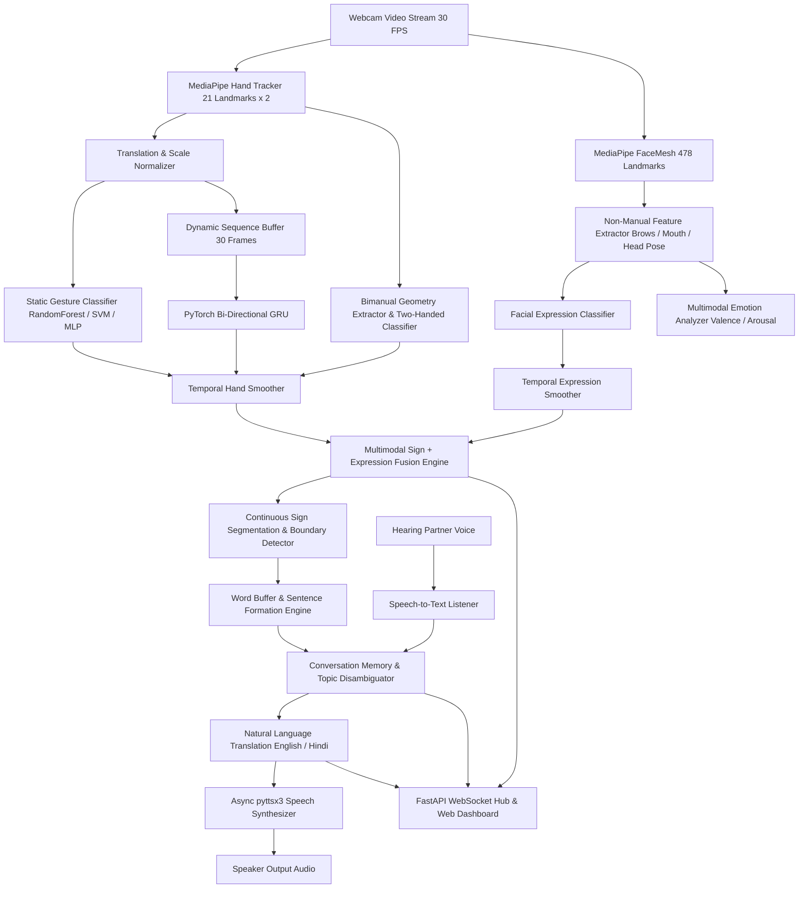

# Samvaad (SignBridge)
## Real-Time Multimodal Sign Language & Accessibility Platform

**Samvaad** (संवाद / *Dialogue*) is an AI-powered multimodal sign language communication and translation system. It bridges communication gaps between Deaf/Hard-of-Hearing individuals and hearing individuals in real-time through simultaneous hand tracking, 478-point 3D facial expression analysis, non-manual linguistic marker fusion, bi-directional English/Hindi translation, asynchronous voice synthesis (TTS), speech-to-text (STT) for hearing partners, and a modern accessible Web UI.

---

## 🌟 Core System Architecture & Features



---

## 📁 Repository Structure

```
c:\gestures\
├── backend/
│   ├── benchmarking/           # Phase 23: Latency & performance profiler
│   │   ├── __init__.py
│   │   └── profiler.py
│   ├── camera/                 # Phase 1: Camera manager & threaded video capture
│   │   ├── __init__.py
│   │   ├── manager.py
│   │   └── video_stream.py
│   ├── config/                 # Centralized type-safe Pydantic configuration
│   │   ├── __init__.py
│   │   └── settings.py
│   ├── conversation/           # Phase 13: Dialogue memory, context tracking & disambiguation
│   │   ├── __init__.py
│   │   ├── context_manager.py
│   │   ├── disambiguator.py
│   │   ├── memory.py
│   │   └── models.py
│   ├── dynamic_gesture/        # Phase 8 & 17: PyTorch GRU dynamic sequences & augmentor
│   │   ├── __init__.py
│   │   ├── augmentor.py
│   │   ├── evaluator.py
│   │   ├── model.py
│   │   ├── network.py
│   │   ├── sequence_buffer.py
│   │   └── trainer.py
│   ├── emotion/                # Phase 19: Multimodal emotion & sentiment analysis
│   │   ├── __init__.py
│   │   ├── analyzer.py
│   │   └── models.py
│   ├── expression_recognition/ # Phase 11: Facial expression classification & smoothing
│   │   ├── __init__.py
│   │   ├── classifier.py
│   │   ├── models.py
│   │   └── smoother.py
│   ├── face_detection/         # Phase 10: 478 3D facial landmark mesh & non-manual markers
│   │   ├── __init__.py
│   │   ├── detector.py
│   │   ├── markers.py
│   │   ├── models.py
│   │   └── visualizer.py
│   ├── gesture_recognition/    # Phase 6 & 7: Static gesture classifier & temporal smoother
│   │   ├── __init__.py
│   │   ├── classifier.py
│   │   ├── models.py
│   │   ├── smoother.py
│   │   └── trainer.py
│   ├── hand_detection/         # Phase 2: Dual-hand tracking & landmark extraction
│   │   ├── __init__.py
│   │   ├── detector.py
│   │   ├── models.py
│   │   └── visualizer.py
│   ├── multimodal_fusion/      # Phase 12: Sign + Expression semantic synthesis
│   │   ├── __init__.py
│   │   ├── engine.py
│   │   ├── models.py
│   │   └── rules.py
│   ├── personalization/        # Phase 22: Offline user calibration & profile manager
│   │   ├── __init__.py
│   │   ├── calibrator.py
│   │   └── models.py
│   ├── preprocessing/          # Phase 3: Coordinate normalization & feature extraction
│   │   ├── __init__.py
│   │   ├── extractor.py
│   │   ├── normalizer.py
│   │   └── validator.py
│   ├── segmentation/           # Phase 21: Continuous sign segmentation & coarticulation
│   │   ├── __init__.py
│   │   ├── boundary_detector.py
│   │   └── models.py
│   ├── sentence_formation/     # Phase 9: Hold debouncer, word buffer & sentence engine
│   │   ├── __init__.py
│   │   ├── engine.py
│   │   ├── linguistic_rules.py
│   │   ├── models.py
│   │   └── word_buffer.py
│   ├── server/                 # Phase 16: FastAPI backend & accessibility web dashboard
│   │   ├── __init__.py
│   │   ├── app.py
│   │   ├── models.py
│   │   └── static/
│   │       ├── app.js
│   │       ├── index.html
│   │       └── style.css
│   ├── stt/                    # Phase 20: Hearing partner speech-to-text listener
│   │   ├── __init__.py
│   │   ├── models.py
│   │   └── transcriber.py
│   ├── tests/                  # 174 Unit and Integration Tests (100% Pass Rate)
│   ├── translation/            # Phase 14: Natural language translation (English/Hindi)
│   │   ├── __init__.py
│   │   ├── grammar_rules.py
│   │   ├── models.py
│   │   └── translator.py
│   ├── tts/                    # Phase 15: Asynchronous voice synthesis engine
│   │   ├── __init__.py
│   │   ├── audio_player.py
│   │   ├── models.py
│   │   └── synthesizer.py
│   ├── two_handed/             # Phase 18: Compound bimanual sign recognition
│   │   ├── __init__.py
│   │   ├── classifier.py
│   │   ├── geometry.py
│   │   └── models.py
│   ├── vocabulary/             # Phase 9: ISL dictionary profiles & registry
│   │   ├── __init__.py
│   │   ├── loader.py
│   │   ├── models.py
│   │   └── registry.py
│   └── main.py                 # Live multimodal runtime pipeline & OpenCV HUD
├── config/                     # Configuration and vocabulary dictionary profiles
│   ├── profiles/               # User calibration profiles
│   └── vocabularies/           # ISL vocabulary JSON profiles
├── run_app.py                  # Entrypoint: Launch full desktop HUD pipeline
├── run_server.py               # Entrypoint: Launch accessibility web server & dashboard
└── requirements.txt            # Python dependencies
```

---

## 🚀 Quickstart & Usage

### 1. Installation
```powershell
# Create and activate virtual environment
python -m venv .venv
.\.venv\Scripts\activate

# Install dependencies
pip install -r requirements.txt
```

### 2. Launch Accessibility Web Dashboard
```powershell
python run_server.py
```
Open your browser and navigate to:
👉 **`http://127.0.0.1:8000`**

### 3. Launch Desktop OpenCV HUD Application
```powershell
python run_app.py
```
**Interactive Hotkeys:**
- `[Q]`: Quit application
- `[C]`: Clear current sentence buffer
- `[ENTER]`: Manually commit current sentence to dialogue history and vocalize
- `[V]`: Toggle Voice Synthesis (TTS on/off)
- `[H]`: Switch Target Spoken Language (English $\leftrightarrow$ Hindi)
- `[P]`: Simulate hearing partner reply in conversation context

### 4. Running Complete Test Suite
```powershell
pytest backend/tests/ -v
```
*Current test suite status: **174 passed (100% pass rate)**.*
# Gestures

